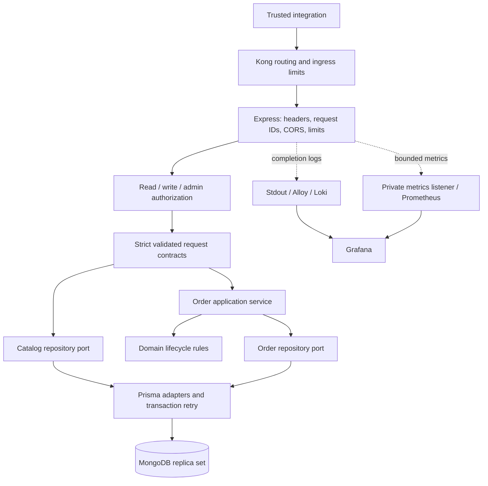
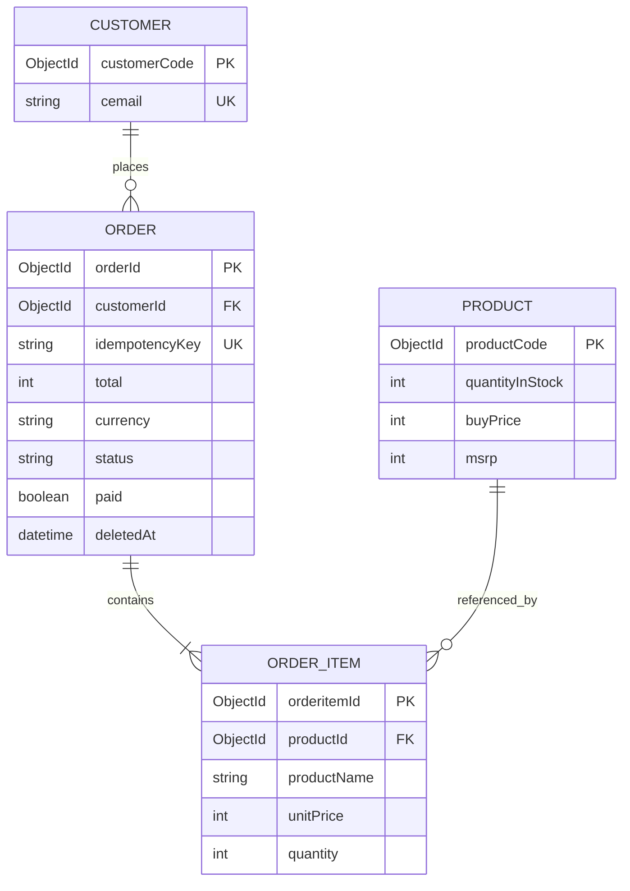

# 🛒 Clean TypeScript Shop API — Customers, Products & Orders

[](https://nodejs.org/)
[](https://www.typescriptlang.org/)
[](https://expressjs.com/)
[](https://www.prisma.io/)
[](https://www.mongodb.com/)
[](LICENSE)

A TypeScript commerce backend for **customers, products, inventory, orders, and administrative
user profiles**. Built with Express, Prisma, and MongoDB, it demonstrates how a layered CRUD API
can grow into a modular monolith with explicit contracts, transactional order processing,
inventory protection, runtime validation, and a reproducible container deployment.

This Part 5 backend keeps the project's Clean Architecture intent while simplifying forwarding-only
services and use cases. **Burhan Saadi — Architecture & Development.**

> **Application boundary:** this API serves trusted back-office applications and server integrations.
> Read, write, and admin credentials grant application-wide access. They are not customer sessions.
> A customer-facing application needs a separate identity layer and ownership checks. Never embed
> write/admin credentials in browser or mobile bundles.

---

## 📐 Architecture & Flow

One deployable Node.js application owns the commerce operations and MongoDB database. Compose
runs two identical replicas behind Kong; each replica independently validates credentials.



| Layer                 | Responsibility                                                               | Where to look                        |
| --------------------- | ---------------------------------------------------------------------------- | ------------------------------------ |
| Bootstrap/composition | Validate config, create one Prisma client, inject adapters, listen and drain | `src/bin/www.ts`, `src/config.ts`    |
| Presentation          | Routes, DTO validation, credentials, HTTP errors, bounded metrics            | `src/app.ts`, `src/ca_presentation/` |
| Application           | Normalize retry requests and orchestrate order operations                    | `src/ca_application/orders.ts`       |
| Domain                | Framework-independent models, repository ports and business errors           | `src/ca_domain/`                     |
| Infrastructure        | Persistence, transactions, stock changes, projections and logs               | `src/ca_infrastructure/`             |

Simple catalog CRUD calls an injected repository port directly; it does not pass through empty
service/use-case wrappers. Order persistence coordinates database writes atomically and invokes
the lifecycle policy before changing state. HTTP error translation stays at the API boundary.

### Data model



User profiles are separate from order/customer identity. No password field exists in the current
Prisma contract. Explicit user projections also exclude password fields left in legacy records.
MongoDB has no SQL foreign keys; transactionally touching referenced customer/product records
serializes order writes against deletion, and reference checks protect retained order history.

## ✨ Key Features

- **Access control:** every `/api` route validates `x-api-key`; write/admin privileges are explicit.
- **Strict contracts:** ObjectIds, bounded pagination, dates, integer money, nested items and unknown fields.
- **Atomic commerce operations:** order, item and inventory writes commit or roll back together.
- **Retry-safe creation:** unique idempotency keys and normalized request fingerprints.
- **Inventory protection:** conditional stock decrements, conflict retries and signed adjustments.
- **Historical pricing:** purchase-time name/price snapshots and server-calculated totals.
- **Order lifecycle:** payment checks, controlled shipping/cancellation and soft deletion.
- **Operational support:** health checks, graceful shutdown, request IDs, safe logs and private metrics.
- **Verification:** unit/API regression tests, real MongoDB integration tests and gated image publishing.

## 📂 Repository Structure

```text
backendcleants_p5/
├── src/
│   ├── app.ts                       # HTTP routes and injected application dependencies
│   ├── config.ts                    # Validated settings and distinct credentials
│   ├── bin/www.ts                   # Bootstrap, listeners and graceful shutdown
│   ├── ca_domain/                   # Models, ports and business errors
│   ├── ca_application/orders.ts     # Order service and lifecycle policy
│   ├── ca_infrastructure/
│   │   ├── database/schema.prisma   # Supported MongoDB contract
│   │   ├── database/catalog.ts      # Customer/product/profile persistence
│   │   ├── database/orders.ts       # Atomic orders and inventory
│   │   └── logging/logger.ts        # Structured stdout logs
│   └── ca_presentation/             # Validation, authorization, errors and metrics
├── test/unit/                       # Domain, security and HTTP regression tests
├── test/integration/                # Dedicated MongoDB replica-set tests
├── scripts/                         # Key generation, guarded schema setup, OpenAPI generation
├── docs/openapi.json                # Generated API specification
├── docs/UPGRADING.md                # Breaking contracts and existing-data migration guidance
├── monitoring/                      # Alloy collection and Grafana data sources
├── .github/workflows/ci.yml         # Checks, integration tests, image build and tag publishing
├── Dockerfile                       # Tooling stage and minimal non-root runtime
├── docker-compose.yml              # Replica set, schema job, two APIs and Kong
├── docker-compose.test.yml          # Disposable isolated integration database
├── .env.example                    # Safe environment template
└── rest-client.http                 # Editable request examples
```

## 🧠 Architecture Concepts

### Transactions and concurrent stock changes

MongoDB must be a **replica set**; standalone deployments cannot run the required transactions.
Order creation touches the customer, conditionally decrements each product's available stock,
creates item snapshots and saves the server-calculated total inside one transaction. Product
operations run in sorted ID order. Failed operations roll back all related changes.

Updates obtain an order write conflict through its revision counter. Replacing items releases
previous reservations and reserves the replacement set in the same transaction. Retained products
keep their original line prices; newly added products use their current selling price. Prisma
write conflicts receive up to four transaction attempts with short jittered backoff. Exhausted
conflicts return 409; callers can retry with appropriate backoff.

### Idempotency and safe retries

`POST /api/order` requires an `Idempotency-Key` containing 8–128 ASCII letters, digits, underscores
or hyphens. Item order is normalized before hashing. The key is unique in the database, so
concurrent duplicate requests cannot create two orders or reserve inventory twice.

The same key and input returns the current stored order; different input returns 409. The key is
retained after soft deletion and a retry returns the tombstone rather than creating another order.
Both initial creation and replay return 201. Keys and request hashes are excluded from responses.
This is state replay, not a cache of the original HTTP response.

### Money and lifecycle

All prices and totals use **integer currency minor units**: `250` means 2.50 for a currency with
two decimal places. The server does not convert currencies. Configure one currency with `CURRENCY`;
it is snapshotted on each order. Do not change it for an existing catalog without a reviewed conversion.

| Operation                    | Behavior                                                                            |
| ---------------------------- | ----------------------------------------------------------------------------------- |
| Create                       | Pending, unpaid; reserve stock and calculate total from item prices                 |
| Replace items                | Pending and unpaid only, 1–100 distinct products; quantities 1–10,000               |
| Confirm payment              | Admin-only `paid` change after external settlement/refund confirmation              |
| Ship                         | Admin-only, requires payment confirmation                                           |
| Cancel                       | Pending only; must be unpaid, releases stock once                                   |
| Delete                       | Unpaid and unshipped only; releases pending stock and retains a cancelled tombstone |
| Edit shipped/cancelled order | Comments/date metadata only; items, payment and lifecycle are immutable             |

Empty item arrays are rejected; cancellation/deletion are explicit operations. Referenced products
and customers cannot be deleted, even when the referencing order is soft-deleted. Product stock
uses signed adjustments rather than absolute overwrites after creation.

## 🚀 Getting Started

Use Node.js 24, npm, and Docker with Linux containers. The package accepts Node 22 or newer;
the container and CI use Node 24. Prisma is pinned to 6.19 for the supported MongoDB connector.

### Configure credentials

```bash
npm ci --ignore-scripts
npm run generate
cp .env.example .env
npm run keys
```

On PowerShell, use `Copy-Item .env.example .env` instead of `cp`. **Preserve an existing `.env`
before replacing it.** Copy the four generated values into `.env`; the three API keys must be
distinct and at least 32 characters. `.env` is ignored and excluded from Docker builds.
The key command prints new values; it does not overwrite files or rotate external accounts.

### Run the container stack

```bash
docker compose up --build -d --wait
```

Compose starts MongoDB, initializes a single-member replica set, runs the guarded schema job,
then starts two API replicas and Kong. Kong is available at `http://localhost:8000` and MongoDB
at `127.0.0.1:27017` for local development. Backend and metrics ports are not published; Kong's
admin listener is disabled. API authorization remains active even if ingress is bypassed.

The local database is unauthenticated, loopback-bound and isolated on the Compose private network.
This is a development setup. Use an authenticated managed replica set, private networking and TLS
for production. Docker volumes retain data across restarts; do not use `down -v` on data you need.

### Run Node locally

```bash
docker compose up -d mongo mongo-init
npm run db:push
npm run dev
```

Local Node listens at `http://localhost:3000`; use that URL instead of Kong when running only the
database services. The example connection string includes `directConnection=true` so the host
client can reach the single local replica-set member through its loopback port mapping.

`npm run db:push` checks the database contract before applying indexes. Existing unversioned
application data is refused; see [the upgrade guide](docs/UPGRADING.md) before using an old database.
It never automatically converts historical prices, inventory or credentials.

### Environment variables

| Variable                 | Purpose / default                                                                 |
| ------------------------ | --------------------------------------------------------------------------------- |
| `NODE_ENV`               | `development`, `test` or `production`                                             |
| `PORT`                   | Local API port, default 3000; Compose fixes replica ports at 3000                 |
| `MONGODB_URL`            | Required replica-set URI; use authenticated credentials outside local development |
| `API_READ_KEY`           | Read access to customer/product/order routes                                      |
| `API_WRITE_KEY`          | Read access plus commerce writes                                                  |
| `API_ADMIN_KEY`          | All access, including payment/shipping and user profiles                          |
| `CURRENCY`               | Three uppercase letters, default USD; single catalog currency                     |
| `CORS_ORIGINS`           | Comma-separated exact HTTP origins; empty denies browser cross-origin access      |
| `RATE_LIMIT_MAX`         | Per-process API requests per minute per IP, default 120                           |
| `GRAFANA_ADMIN_PASSWORD` | Required by Compose; generate with the credential command                         |
| `TEST_MONGODB_URL`       | Dedicated test replica-set URI whose database ends in `_test`                     |

## 📡 API Reference & Examples

The [OpenAPI specification](docs/openapi.json) describes request/response schemas and routes.
Regenerate it after schema changes with `npm run docs:generate`. Import it into an API client,
or use [rest-client.http](rest-client.http). Health checks do not require credentials.

| Routes                                                  | Access                                                  |
| ------------------------------------------------------- | ------------------------------------------------------- |
| `GET /api/customer`, `/api/product`, `/api/order`       | Read or higher                                          |
| `GET /api/{customer,product,order}/:id`                 | Read or higher                                          |
| `GET /api/{customer,product}/name/:name`                | Read or higher; exact name match                        |
| `GET /api/order/customer/:customerId`                   | Read or higher; paginated orders                        |
| `POST /api/{customer,product,order}`                    | Write or higher                                         |
| `PUT`, `DELETE /api/{customer,product,order}/:id`       | Write or higher; payment/shipping changes require admin |
| `POST /api/product/:id/stock`                           | Write or higher; `{ "delta": 5 }`                       |
| `/api/user`, `/api/user/id/:id`, `/api/user/name/:name` | Admin only; user profiles, no login endpoints           |
| `GET /health/live`, `/health/ready`                     | Public                                                  |

PUT uses partial-update semantics and requires at least one allowed field. All IDs are MongoDB
ObjectIds. Unknown fields and explicit null update values are rejected. Lists return
`{ "items": [], "total": 0, "offset": 0, "limit": 20 }` with a stable ID order. Offset is 0–100,000
and limit is 1–100. Order lists include bounded item collections. Deletes return an empty 204.

Create an order after creating a customer and product:

```http
POST http://localhost:8000/api/order
x-api-key: YOUR_WRITE_KEY
Idempotency-Key: purchase-example-0001
Content-Type: application/json

{
  "customerId": "REPLACE_WITH_CUSTOMER_OBJECT_ID",
  "comments": "Deliver during business hours",
  "orderItems": [{ "productId": "REPLACE_WITH_PRODUCT_OBJECT_ID", "quantity": 2 }]
}
```

The response includes the calculated total, currency and line snapshots. Creation rejects
caller-supplied `paid`, `total`, `status` and IDs. Payment is a manual administrative confirmation;
the API does not process money, initiate refunds or integrate with a payment provider.

## 🧪 Testing & Verification

See [the review fixes and local verification record](docs/REVIEW-FIXES.md) for issue-by-issue coverage.

```bash
npm run lint
npm run typecheck
npm run build
npm test
npm run docs:generate
npm audit --omit=dev
```

Run real transaction and concurrency tests with the isolated test stack:

```powershell
docker compose -f docker-compose.test.yml up -d --wait
$env:TEST_MONGODB_URL = 'mongodb://127.0.0.1:27018/shop_test?replicaSet=rs0&directConnection=true&serverSelectionTimeoutMS=5000'
npm run test:integration
docker compose -f docker-compose.test.yml down
```

On Bash, set the variable with `export TEST_MONGODB_URL='...'`. Tests never inherit the application's
database URI. They require a `_test` database name, create a fresh randomly named database per run,
and drop only that database afterward. The test server uses temporary storage and port 27018.

Tests cover direct authorization, privileged-field rejection, safe user projections, corrected
routes, validation, logging, metric labels, concurrent overselling, duplicate retries, failed
creation/update rollback, historical price preservation, payment transitions and deletion history.
CI runs these checks and builds the production image. A `v*` tag publishes to GHCR only after the
verification job succeeds. Local checks do not publish anything.

## 📊 Observability & Operations

```bash
docker compose --profile monitoring up -d
```

Prometheus (`http://localhost:9090`) scrapes **both** private API metrics listeners on port 9464.
Grafana (`http://localhost:4000`, login `admin` with your generated password) provisions Prometheus
and Loki sources. Alloy sends this Compose project's API stdout logs to Loki, labelled by service
and container. The optional
collector mounts the Docker socket and must run only on trusted development hosts.

HTTP completion logs contain a generated request ID, route template, method, status and duration.
They omit request bodies, credentials, raw query strings and driver arguments. Metric labels use
route templates, never individual IDs. Docker rotates JSON logs and Loki retains seven days.
Expose metrics only on a private network; local Node also binds the metrics listener to all interfaces.

Liveness checks the process; readiness pings the database and becomes unavailable while draining.
SIGTERM/SIGINT stop accepting requests, drain active work, close metrics and disconnect Prisma,
with a 20-second shutdown deadline. Readiness does not verify all indexes or schema drift.

## 🚢 Production Notes & Current Scope

- Put Kong behind TLS and restrict network access. Replace the local unauthenticated MongoDB
  service with an authenticated replica set and backups. Test restoration and capacity planning.
- Keep credentials in a secret store; rotate them with a coordinated client rollout. Previously
  committed secrets remain in Git history until separately remediated; see the upgrade guide.
- The API's rate limiter is per process, and Kong's local ingress counter is shared only within
  that gateway process. Multiple gateways need a distributed ingress policy. Proxy trust defaults
  to disabled; configure trusted proxy addresses deliberately before using client-IP limits behind proxies.
- JSON bodies are capped at 128 KiB; compressed JSON is rejected. Security headers and explicit
  browser origins are configured. CORS is not an authorization mechanism.
- The example MongoDB URI caps each API pool at 10 and selection timeout at five seconds. Size
  total connections across replicas against database capacity. Transactions time out after 15 seconds.
- The production image runs as `node`, excludes development tooling, secrets, tests and runtime data,
  and Compose applies a read-only filesystem, dropped capabilities and bounded logs.
- Dependency overrides patch Prisma CLI merge/effect utilities and lint glob utilities. Both client
  generation and database setup exercise the patched CLI. Reassess overrides during upgrades.
- Current scope excludes customer login, tenant isolation, payment settlement/refund automation,
  taxes, discounts, durable actor-level audit trails and multi-currency conversion.

## 🧯 Errors & Troubleshooting

Errors use `{ "error": { "code": "...", "message": "...", "details": [] }, "requestId": "..." }`;
`details` is present for validation errors. Unexpected failures return safe messages.

| Status / symptom                   | Meaning / action                                                                                       |
| ---------------------------------- | ------------------------------------------------------------------------------------------------------ |
| 400                                | Invalid DTO, ObjectId, pagination, retry key or malformed JSON; inspect validation fields              |
| 401                                | Missing or invalid `x-api-key`                                                                         |
| 403                                | Credential lacks write/admin scope                                                                     |
| 404                                | Route/resource missing, including a deleted order                                                      |
| 409                                | Duplicate value, stock/state/reference conflict, different retry input, or exhausted concurrency retry |
| 413 / 415                          | JSON exceeds 128 KiB or uses unsupported compression                                                   |
| 429                                | Reduce request rate and honor rate-limit headers                                                       |
| 500                                | Unexpected failure; correlate the response request ID with server logs                                 |
| 503 on readiness                   | Database unavailable or process draining                                                               |
| Startup configuration error        | Set required variables and three distinct credentials                                                  |
| Transaction/replica-set error      | Use Atlas or the initialized local replica set, not standalone MongoDB                                 |
| Schema setup refuses existing data | Follow [UPGRADING.md](docs/UPGRADING.md); do not reset or bypass the guard                             |

## 👨‍💻 Author & License

**Burhan Saadi — Architecture & Development.** This repository illustrates layered TypeScript
backend design, dependency inversion, REST contracts, MongoDB transactions and operational tooling.

Copyright (c) 2024 Burhan Saadi. Licensed under the [MIT License](LICENSE). Dependency licenses
remain their respective authors' terms.
